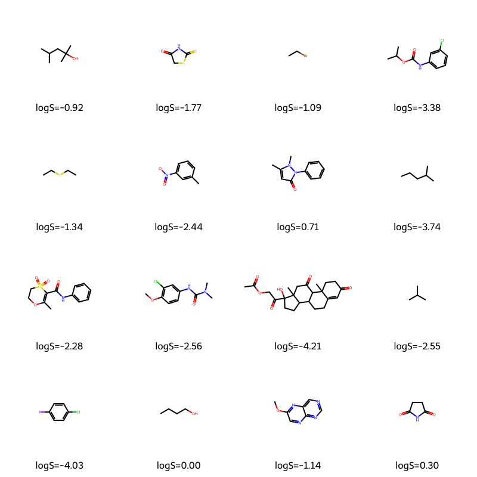
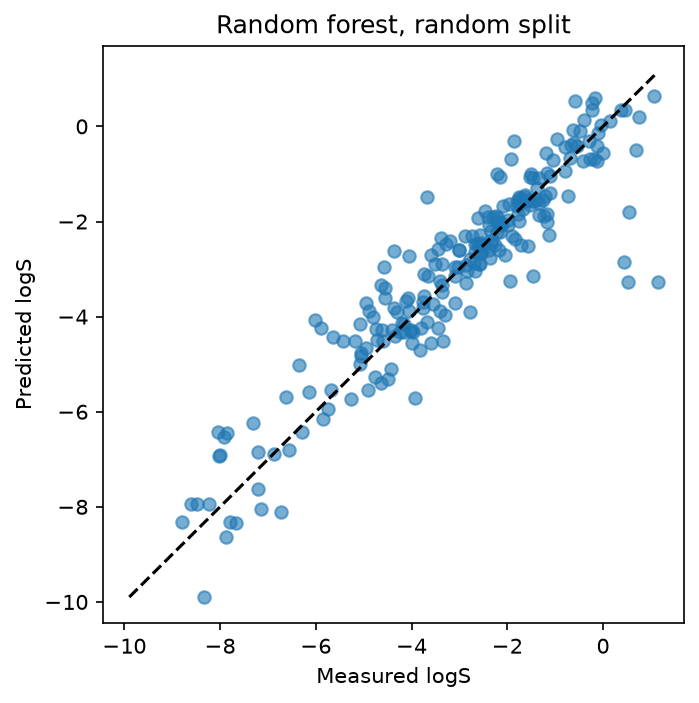
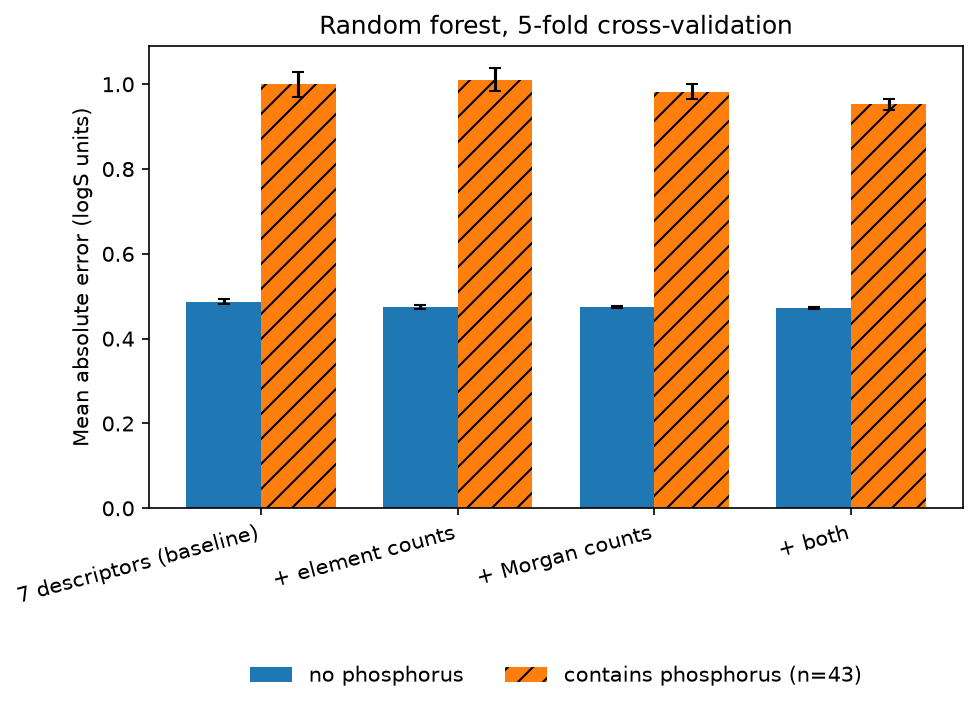

# Can you predict how well a molecule dissolves in water using machine learning?

I'm a second-year Chemistry with Maths student at UCL, and I wanted a small project that put machine learning to work on a real chemistry question. Solubility is a good one: it matters for drug design and environmental chemistry, and chemists already have decent rules of thumb for it (polar groups help, big greasy aromatic systems hurt). So the question is how much of that a model can pick up from structure alone.

The quantity I'm predicting is **logS**: where S is a molecule's solubility in water, in moles per litre. So logS = -3 means 0.001 mol/L, and a higher (less negative) value means more soluble.

## Key findings

- A random forest on seven RDKit descriptors predicts logS with a typical error (RMSE) of 0.71 log units in cross-validation, against about 1.0 for linear regression and 2.1 for always guessing the average.
- On ring frameworks it hasn't seen, its error rises to 0.80, about 13% worse.
- logP (lipophilicity) does most of the work, which fits the chemistry.
- The biggest remaining errors are 10 phosphates and phosphonates (compounds with a P=O group), which the model predicts as 2.6 log units less soluble than measured on average. Element counts and Morgan fingerprints don't fix this, and Delaney's original ESOL equation gets the same compounds wrong in the same direction. (Possible reasons below, see 'Why might P=O compounds be hard)



*A random sample of 16 molecules from the dataset, labelled with their measured logS. Small polar molecules sit near or above zero, while the least soluble in this sample (about -3.7 to -4.2) are a steroid, a chloro-iodobenzene and a small alkane.*

## How I tested it

Each molecule starts as a SMILES string (a line of text that encodes its structure, such as `CCO` for ethanol), which RDKit, a chemistry toolkit for Python, turns into seven descriptors: molecular weight, logP (how much a molecule prefers fat-like surroundings to water-like ones), hydrogen bond donors and acceptors, rotatable bonds (a measure of flexibility), polar surface area (the surface area contributed by polar atoms such as O and N) and the proportion of aromatic atoms.

I compared three models:

- **Predict the mean** always guesses the average logS of the training data. It's the floor any real model has to beat.
- **Linear regression** fits a weighted sum of the descriptors.
- **Random forest** averages the predictions of many decision trees.

Each model was scored with 5-fold cross-validation: the data is split into five parts, and each part is predicted by a model trained on the other four, so every molecule gets a prediction from a model that never saw it. I repeated this with three different shuffles and report the average. I ran it two ways:

- **Random folds:** molecules are assigned to folds at random.
- **Scaffold folds:** molecules that share a ring framework (the molecule with its side chains stripped off, called a Murcko scaffold) always land in the same fold, so the model is always tested on frameworks it hasn't seen. Ring-free molecules have no framework to share, so each counts as its own group.

**How to read the numbers.** RMSE (root mean squared error) is the typical size of a prediction error, in logS units, so lower is better. An RMSE of 0.8 means predictions are typically about 0.8 log units off, roughly a factor of 6 in solubility. MAE (mean absolute error) is the average size of the error, ignoring its direction. R² is the fraction of the variation in logS that the model explains: 1 is perfect, 0 is no better than guessing the average, and a negative value is worse than that.

## Results

### Model comparison

| Model | Folds | RMSE | R² |
|---|---|---|---|
| Predict the mean | random | 2.098 | -0.003 |
| Linear regression | random | 0.995 | 0.774 |
| Random forest | random | 0.709 | 0.885 |
| Predict the mean | scaffold | 2.115 | -0.018 |
| Linear regression | scaffold | 1.023 | 0.762 |
| Random forest | scaffold | 0.804 | 0.853 |

*Mean over three shuffles of the folds. The standard deviation across shuffles was 0.007 or less for every number.*

The random forest is clearly the best model. Its error rises on unseen ring frameworks (0.709 to 0.804), while linear regression barely changes (0.995 to 1.023).

I started with a single 80/20 split, which gave the same ranking but higher errors (forest RMSE 0.82 on a random split and 0.96 on a scaffold split; the full table is in `results.csv`). That split happened to be a harder-than-average test set, and it made linear regression look as badly hit by new frameworks as the forest (about 18% worse). The single scaffold split was also a harsher test than the scaffold folds, because it deliberately left the rarest frameworks for testing.

**Which descriptors matter.** In the random forest, logP carries most of the importance (about 0.82), followed by molecular weight (about 0.10) and polar surface area (about 0.04). The other four are each below 0.02. Importance is a score for how much the forest relies on each descriptor, and the scores add up to 1.



*Random forest on the single random split. Points on the dashed line are perfect predictions.*

### Where it goes wrong

The cluster of points well below the line on the right is four phosphorus compounds, measured as quite soluble (logS 0.4 to 1.1) but predicted as much less soluble. Across cross-validation, the 43 phosphorus compounds in the dataset have an MAE of 1.00 log units, about twice the 0.49 for everything else.

**Better features don't fix it.** My first guess was that none of the seven descriptors encodes phosphorus directly. So I added element counts (how many C, N, O, S, P, F, Cl, Br and I atoms a molecule has) and Morgan count fingerprints (1,024 bins recording which small substructures, such as P=O groups, a molecule contains).

| Features | RMSE (all molecules) | MAE, no phosphorus | MAE, phosphorus (n=43) |
|---|---|---|---|
| 7 descriptors (baseline) | 0.709 | 0.488 | 1.000 |
| + element counts | 0.686 | 0.475 | 1.010 |
| + Morgan counts | 0.681 | 0.475 | 0.982 |
| + both | 0.675 | 0.472 | 0.953 |

*Random forest, 5-fold cross-validation, mean over three shuffles. Shuffles moved these numbers by about 0.03 or less. The bias and spread are in `results_features.csv`.*



Overall error fell slightly, but the phosphorus error barely moved. Element counts made the phosphorus errors less one-sided (the average of measured minus predicted fell from +0.61 to +0.42) without making them smaller.

**The problem is the P=O group.** The phosphorus compounds fall into two chemical classes: 33 thiophosphates, with a P=S group, and 10 phosphates and phosphonates, with a P=O group. I split the errors by class and compared them with Delaney's original ESOL equation, whose predictions come with the dataset.

| Group | n | MAE: forest | MAE: forest + both feature sets | MAE: ESOL equation |
|---|---|---|---|---|
| No phosphorus | 1,085 | 0.49 | 0.47 | 0.70 |
| P=S | 33 | 0.55 | 0.59 | 0.47 |
| P=O | 10 | 2.62 | 2.19 | 1.40 |

The forest handles the thiophosphates about as well as everything else. On the 10 P=O compounds it is off by 2.6 log units on average and predicts essentially every one of them as less soluble than measured. The worst cases are small, very soluble compounds such as vamidothion, Dimecron, acephate and triethyl phosphate. The ESOL equation gets the same compounds wrong in the same direction, though by less (1.40). It was fitted by Delaney rather than cross-validated here, so the comparison is only a rough guide, but it suggests these molecules are genuinely hard, not a quirk of my model.

**Why might P=O compounds be hard?** I haven't tested these, but there are three plausible reasons, and they aren't mutually exclusive:

- **The P=O oxygen accepts hydrogen bonds much more strongly than most oxygens.** Most oxygens can accept hydrogen bonds, but the P=O bond is so polarised (closer to P⁺–O⁻ than a true double bond) that this oxygen binds water far more strongly than the oxygen in an ether, ester or ketone. Water therefore solvates these molecules much better than their size suggests. The descriptors don't capture that difference: the acceptor count scores the P=O oxygen the same as any other oxygen, and Crippen's logP, which the model relies on most, may rate these compounds as more lipophilic than they are.
- **Thiophosphates behave the opposite way.** Sulfur in a P=S group forms at most very weak hydrogen bonds, so thiophosphates are greasy and insoluble (average measured logS -4.56, against -1.49 for the P=O compounds). The two classes look alike to the model, and counting phosphorus atoms can't tell them apart, so the 10 P=O compounds may get pulled towards the 33 thiophosphates.
- **Several are liquids or low-melting solids,** such as triethyl phosphate and Dimecron. Liquids don't pay the energy cost of breaking up a crystal lattice, so they dissolve more readily than a model trained mostly on solids expects, and none of the descriptors encode melting point.

With only 10 P=O compounds, about 8 per training fold, the forest also has very few examples to learn from.

### Caveats

- The phosphorus conclusions rest on small numbers: 43 phosphorus compounds and only 10 with a P=O group. That uncertainty is larger than the spread between fold shuffles, so small differences in the tables aren't meaningful.
- I chose the extra features after seeing where the model failed.
- The ESOL equation was not cross-validated here, so comparing it with the forest is only a rough guide.

## Why I stopped here

I could test the three explanations above, but I decided not to. With only 10 P=O compounds, no test on this dataset could tell the explanations apart: a feature that marks P=O groups would be fitted to the same 10 molecules I used to find the problem, so any improvement would mostly reflect that rather than show why they're hard. Checking computed logP or melting points would mean collecting outside data for each compound, which would be a bigger project than this one. A convincing answer would need a much larger set of phosphates and phosphonates with measured solubility, such as from a bigger database like AqSolDB, which is where I'd start if I picked this up again.

## The data

ESOL is a well-known benchmark of 1,128 small molecules with measured aqueous solubility, given as SMILES strings and logS. Every structure parses, with no missing values or duplicates, and logS runs from about -11.6 to +1.6. The code downloads the DeepChem copy the first time you run it and saves it as `delaney-processed.csv`, so after that it works offline.

Delaney, J. S. *ESOL: Estimating Aqueous Solubility Directly from Molecular Structure.* J. Chem. Inf. Comput. Sci. 2004, 44, 1000-1005.

## What's in the repo

- `molecules.ipynb` is the notebook with the whole analysis, from loading the data to the phosphorus breakdown
- `Solubility.py` has the helper functions `load_data()` and `explore()`
- `results_cv.csv`, `results_features.csv` and `results.csv` are the cross-validated model comparison, the feature comparison and the single-split comparison
- `sample_molecules.png`, `predicted_vs_measured.png` and `feature_comparison.png` are the three figures
- `delaney-processed.csv` is the cached dataset
- `requirements.txt` lists the Python packages

## Running it yourself

You'll need Python 3.

```bash
git clone https://github.com/Ash679-ux/chem-ml-solubility.git
cd chem-ml-solubility

python3 -m venv .venv
source .venv/bin/activate      # on Windows PowerShell: .venv\Scripts\Activate.ps1

pip install -r requirements.txt
```

Then open `molecules.ipynb` in VS Code or Jupyter and run all the cells from the top. The results are reproducible, because every random step uses a fixed seed. The feature comparison fits about 60 random forests, so a full run takes several minutes. You can also use the helper functions directly:

```python
from Solubility import load_data, explore

df = load_data()   # columns: smiles, logS, mol
explore(df)        # prints summary stats and saves sample_molecules.png
```

## Tools

Python, pandas, NumPy, scikit-learn, RDKit, Jupyter and Matplotlib.

## About me

I'm Ashwin, looking for chemistry-related or quantitative analysis internships for summer 2027. If you've got feedback on the project or want to talk about it, I'd be glad to hear from you.