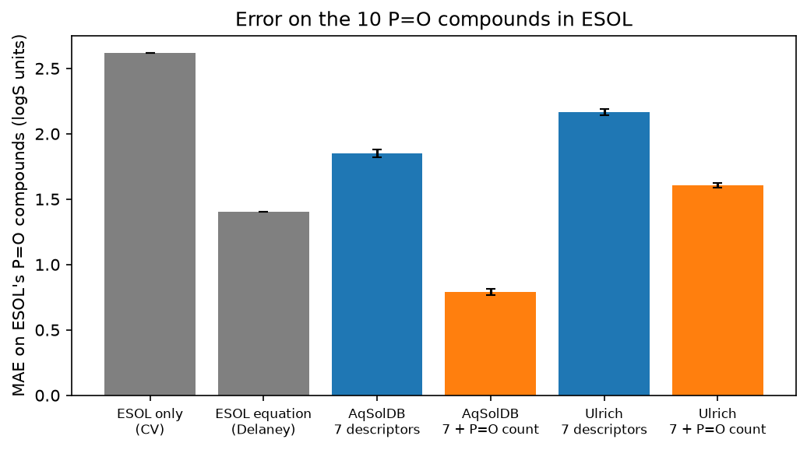
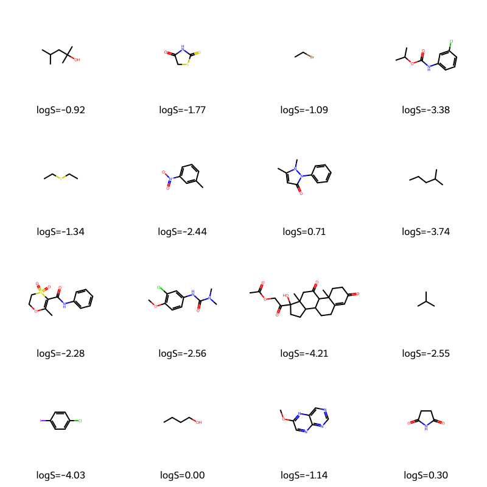
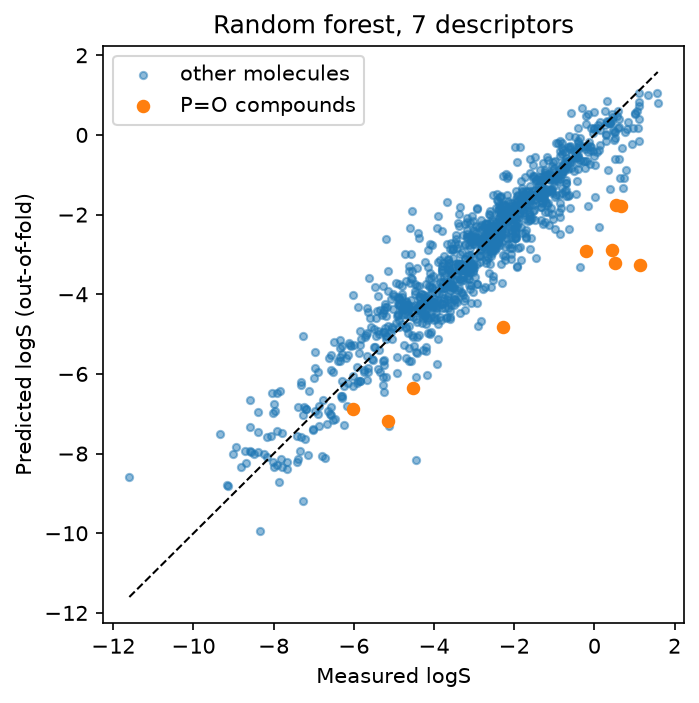
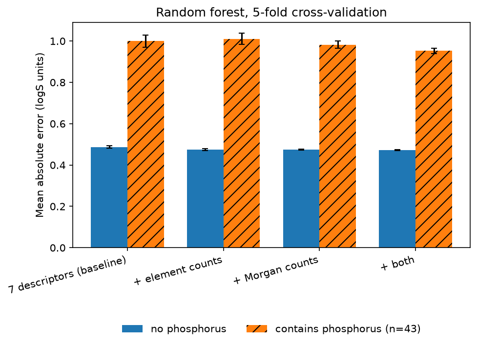

# Can you predict how well a molecule dissolves in water using machine learning?

**In short:** a standard machine-learning model for solubility gets one group of compounds badly wrong: organophosphates with a P=O group, many of them pesticides. I tested why on two larger datasets: with enough examples the errors shrink, and adding an explicit count of P=O groups shrinks them further and removes most of the systematic bias, for compounds with and without rings.



*Error on the 10 P=O compounds in the ESOL dataset. Grey: the original model and Delaney's published equation. Blue and orange: models trained on two larger datasets, without and with a P=O count.*

I'm a second-year Chemistry with Maths student at UCL, and I wanted a small project that put machine learning to work on a real chemistry question. Solubility is a good one: it matters for drug design and environmental chemistry, and chemists already have decent rules of thumb for it (polar groups help, big greasy aromatic systems hurt). So the question is how much of that a model can pick up from structure alone, and where it falls short.

The quantity I'm predicting is **logS**, the base-10 logarithm of a molecule's solubility in water in moles per litre. So logS = -3 means 0.001 mol/L, and a higher (less negative) value means more soluble.

**See it in action:** the follow-up app, [Molecule Property Explorer](https://github.com/Ash679-ux/Molecule-Property-Explorer), builds on this analysis with an improved model and turns it into a web tool ([live demo](https://molecule-explorer.streamlit.app)).

## Key findings

- **A random forest on seven RDKit descriptors predicts logS to within 0.71 log units (RMSE)** in cross-validation, against about 1.0 for linear regression and 2.1 for always guessing the average. On ring frameworks it hasn't seen, the error rises to 0.80.
- **logP (lipophilicity) does most of the work,** which fits the chemistry.
- **Its biggest failures are 10 phosphates and phosphonates** (compounds with a P=O group), which it predicts as 2.6 log units less soluble than measured on average. Element counts and Morgan fingerprints don't fix this, and Delaney's original ESOL equation gets the same compounds wrong in the same direction.
- **More data plus a P=O count fixes most of it.** Trained on a larger dataset (AqSolDB) with every ESOL compound removed, and given the number of P=O groups as an extra feature, the forest's error on ESOL's 10 P=O compounds falls from 1.85 to 0.79 log units, better than Delaney's equation (1.40). Cross-validated over all 155 P=O compounds in a second dataset, the count cuts their error by about 40% and the systematic under-prediction by about two-thirds.
- **The count does more than generic fingerprints.** With the same training data, Morgan fingerprints also reduce the P=O error, but less than the count, and they leave nearly twice the systematic bias. Fingerprints plus the count work best.



*A random sample of 16 molecules from the dataset, labelled with their measured logS. Small polar molecules sit near or above zero, while the least soluble in this sample (about -3.7 to -4.2) are a steroid, a chloro-iodobenzene and a small alkane.*

## How I tested it

Each molecule starts as a SMILES string (a line of text that encodes its structure, such as `CCO` for ethanol). RDKit, a chemistry toolkit for Python, turns it into seven descriptors:

- molecular weight
- logP, how much a molecule prefers fat-like surroundings to water-like ones
- hydrogen bond donors and acceptors
- rotatable bonds, a measure of flexibility
- polar surface area, the surface area contributed by polar atoms such as O and N
- the proportion of atoms that are aromatic

I compared three models:

- **Predict the mean** always guesses the average logS of the training data. It's the floor any real model has to beat.
- **Linear regression** fits a weighted sum of the descriptors.
- **Random forest** averages the predictions of many decision trees.

Each model was scored with 5-fold cross-validation: the data is split into five parts, and each part is predicted by a model trained on the other four, so every molecule gets a prediction from a model that never saw it. I repeated this with three different shuffles and report the average, in two ways:

- **Random folds:** molecules are assigned to folds at random.
- **Scaffold folds:** molecules that share a ring framework (the molecule with its side chains stripped off, called a Murcko scaffold) always land in the same fold, so the model is always tested on frameworks it hasn't seen. Ring-free molecules have no framework to share, so each counts as its own group.

**How to read the numbers.** RMSE (root mean squared error) is the typical size of a prediction error, in logS units, so lower is better. An RMSE of 0.8 means predictions are typically about 0.8 log units off, roughly a factor of 6 in solubility. MAE (mean absolute error) is the average size of the error, ignoring its direction. R² is the fraction of the variation in logS that the model explains: 1 is perfect, 0 is no better than guessing the average, and a negative value is worse than that.

## Results

### Model comparison

| Model | Folds | RMSE | R² |
|---|---|---|---|
| Predict the mean | random | 2.098 | -0.003 |
| Linear regression | random | 0.995 | 0.774 |
| Random forest | random | 0.709 | 0.885 |
| Predict the mean | scaffold | 2.115 | -0.018 |
| Linear regression | scaffold | 1.023 | 0.762 |
| Random forest | scaffold | 0.804 | 0.853 |

*Mean over three shuffles of the folds. The standard deviation across shuffles was 0.007 or less for every number.*

The random forest is clearly the best model. Its error rises on unseen ring frameworks (0.709 to 0.804), while linear regression barely changes (0.995 to 1.023).

I started with a single 80/20 split, which gave the same ranking but higher errors: forest RMSE 0.82 on a random split and 0.96 on a scaffold split (full table in `results.csv`). That split happened to be a harder-than-average test set, and it made linear regression look as badly hit by new frameworks as the forest. The single scaffold split was also a harsher test than the scaffold folds, because it deliberately left the rarest frameworks for testing.

**Which descriptors matter.** In the random forest, logP carries most of the importance (about 0.82), followed by molecular weight (about 0.10) and polar surface area (about 0.04). The other four are each below 0.02. Importance is a score for how much the forest relies on each descriptor, and the scores add up to 1.



*Random forest on the single random split. Points on the dashed line are perfect predictions.*

### Where it goes wrong

The cluster of points well below the line on the right is four phosphorus compounds, measured as quite soluble (logS 0.4 to 1.1) but predicted as much less soluble. Across cross-validation, the 43 phosphorus compounds in the dataset have an MAE of 1.00 log units, about twice the 0.49 for everything else.

**Better features don't fix it.** My first guess was that none of the seven descriptors encodes phosphorus directly. So I added element counts (how many C, N, O, S, P, F, Cl, Br and I atoms a molecule has) and Morgan count fingerprints (1,024 bins recording which small substructures, such as P=O groups, a molecule contains).

| Features | RMSE (all molecules) | MAE, no phosphorus | MAE, phosphorus (n=43) |
|---|---|---|---|
| 7 descriptors (baseline) | 0.709 | 0.488 | 1.000 |
| + element counts | 0.686 | 0.475 | 1.010 |
| + Morgan counts | 0.681 | 0.475 | 0.982 |
| + both | 0.675 | 0.472 | 0.953 |

*Random forest, 5-fold cross-validation, mean over three shuffles. Shuffles moved these numbers by about 0.03 or less. The bias and spread are in `results_features.csv`.*



Overall error fell slightly, but the phosphorus error barely moved. Element counts made the phosphorus errors less one-sided (the average of measured minus predicted fell from +0.61 to +0.42) without making them smaller.

**The problem is the P=O group.** The phosphorus compounds fall into two chemical classes: 33 thiophosphates, with a P=S group, and 10 phosphates and phosphonates, with a P=O group. I split the errors by class and compared them with Delaney's original ESOL equation, whose predictions come with the dataset.

| Group | n | MAE: forest | MAE: forest + both feature sets | MAE: ESOL equation |
|---|---|---|---|---|
| No phosphorus | 1,085 | 0.49 | 0.47 | 0.70 |
| P=S | 33 | 0.55 | 0.59 | 0.47 |
| P=O | 10 | 2.62 | 2.19 | 1.40 |

The forest handles the thiophosphates about as well as everything else. On the 10 P=O compounds it is off by 2.6 log units on average and predicts essentially every one of them as less soluble than measured. The worst cases are small, very soluble compounds such as vamidothion, Dimecron, acephate and triethyl phosphate. The ESOL equation gets the same compounds wrong in the same direction, though by less (1.40). It was fitted by Delaney rather than cross-validated here, so the comparison is only a rough guide, but it suggests these molecules are genuinely hard, not a quirk of my model.

### Why might P=O compounds be hard?

There are three plausible reasons, and they aren't mutually exclusive:

1. **The P=O oxygen accepts hydrogen bonds much more strongly than most oxygens.** The P=O bond is so polarised (closer to P⁺–O⁻ than a true double bond) that this oxygen binds water far more strongly than the oxygen in an ether, ester or ketone, so water solvates these molecules much better than their size suggests. The descriptors miss this: the acceptor count scores the P=O oxygen the same as any other oxygen, and Crippen's logP, which the model relies on most, may rate these compounds as more lipophilic than they are.
2. **They look like thiophosphates, which behave the opposite way.** Sulfur in a P=S group forms at most very weak hydrogen bonds, so thiophosphates are greasy and insoluble (average measured logS -4.56, against -1.49 for the P=O compounds). Counting phosphorus atoms can't tell the two classes apart, so the 10 P=O compounds may get pulled towards the 33 thiophosphates.
3. **Several are liquids or low-melting point solids,** such as triethyl phosphate and Dimecron. Liquids don't pay the energy cost of breaking up a crystal lattice, so they dissolve more readily than a model trained mostly on solids expects, and none of the descriptors encode melting point.

With only 10 P=O compounds, about 8 per training fold, the forest also has very few examples to learn from. That also makes the first explanation hard to test on ESOL alone: a feature that marks P=O groups would be fitted to the same 10 molecules I used to find the problem.

## Testing the P=O explanation on more data

I trained the same random forest on two much larger datasets and tested it on ESOL:

- **AqSolDB** (Sorkun et al., 2019): about 10,000 compounds merged from nine solubility datasets.
- **Ulrich et al. (2025)**: a carefully curated version of AqSolDB plus 2,195 compounds from the literature, 9,800 in total.

Both already contain almost all of ESOL, so I removed every ESOL compound from them first, including other stereoisomers of the same compound. That left 170 P=O compounds to learn from in AqSolDB and 155 in Ulrich. I compared the seven descriptors with the same seven plus **nPO**, the number of P=O groups in the molecule.

| Model | Error on ESOL's 10 P=O compounds (MAE) |
|---|---|
| Forest trained on ESOL only (cross-validated) | 2.62 |
| Delaney's ESOL equation | 1.40 |
| Trained on AqSolDB, 7 descriptors | 1.85 |
| Trained on AqSolDB, 7 descriptors + P=O count | **0.79** |
| Trained on Ulrich, 7 descriptors | 2.16 |
| Trained on Ulrich, 7 descriptors + P=O count | 1.61 |

*Mean over three random-forest seeds; the spread was 0.03 or less. Error on molecules without phosphorus was 0.58 with or without the P=O count.*

Ten test compounds is still a small number, so I also cross-validated inside the Ulrich set, so that all 155 of its P=O compounds are predicted by models that never saw them. I used random folds and scaffold folds, where molecules sharing a ring framework stay in the same fold:

| Folds | MAE on P=O | Mean error on P=O (measured - predicted) | MAE on everything else |
|---|---|---|---|
| Random | 1.39 → 0.85 | +1.23 → +0.44 | 0.66 → 0.66 |
| Scaffold | 1.40 → 0.86 | +1.26 → +0.41 | 0.73 → 0.73 |

*Each arrow goes from 7 descriptors to 7 descriptors + P=O count. 5-fold cross-validation repeated three times, with predictions averaged over the repeats.*

**What this shows:**

- **The P=O count fixes most of the error.** Learned from other compounds, it more than halves the error on ESOL's P=O compounds and cuts the systematic under-prediction inside the Ulrich set by about two-thirds, including on ring frameworks the model hasn't seen. The error on everything else doesn't change. This supports the first explanation: the descriptors underrate how strongly the P=O oxygen accepts hydrogen bonds. (The next section checks how much of this is the feature and how much is the extra data.)
- **The training data matters as much as the features.** Ulrich et al. removed every compound with logS above 0.5 as fully miscible. That leaves only 12 soluble P=O compounds (none above 0.49), against 34 (up to 1.58) in AqSolDB. Four of ESOL's P=O compounds are more soluble than anything in Ulrich's P=O training data, and a random forest can't predict values it has never seen. The cutoff suits Ulrich et al.'s aims, but it removes exactly the compounds that are hardest here.
- **Some under-prediction remains.** The most soluble compounds are still predicted as too insoluble (vamidothion: measured 1.14, predicted -0.13; triethyl phosphate: 0.43 against -1.17). That fits the third explanation, that several are liquids or low-melting solids, which none of the descriptors capture.

**Checking for leaks.** My first pass removed ESOL compounds by exact InChIKey, which missed other stereoisomers of the same compound. Matching on connectivity alone found 99 more in AqSolDB and 84 in Ulrich, including two P=O compounds (Azodrin and Stirofos). Removing them moved the AqSolDB result only from 0.73 to 0.79, so they weren't driving it.

## Is it the P=O count, or just the extra data?

The test above changed two things at once: much more training data, and a new feature. Morgan fingerprints already contain bits for the atom environments around a P=O group, and they didn't help on ESOL, but ESOL only has about 8 P=O compounds per training fold. So I repeated the test with fingerprints trained on the larger datasets.

| Features (trained on Ulrich) | Random folds: MAE on P=O | bias | Scaffold folds: MAE on P=O | bias | Ring-free P=O: MAE |
|---|---|---|---|---|---|
| 7 descriptors | 1.39 (1.25–1.54) | +1.23 | 1.40 (1.26–1.55) | +1.26 | 1.54 |
| 7 + P=O count | 0.85 (0.73–0.97) | +0.44 | 0.86 (0.74–0.98) | +0.41 | 0.83 |
| 7 + Morgan counts | 0.96 (0.86–1.07) | +0.72 | 0.98 (0.87–1.09) | +0.73 | 1.02 |
| 7 + Morgan counts + P=O count | **0.78** (0.67–0.88) | **+0.40** | **0.80** (0.70–0.90) | **+0.37** | **0.80** |

*All 155 P=O compounds in the Ulrich set, cross-validated as above. Brackets are 95% bootstrap intervals, from resampling the P=O compounds. Bias is measured minus predicted. The last column is for the 65 P=O compounds without rings, on scaffold folds.*

On ESOL's 10 P=O compounds, training on AqSolDB gives 1.85 with the 7 descriptors, 1.37 with fingerprints, 0.79 with the P=O count and 0.90 with both.

**What this shows:**

- **More data helps on its own.** With 155 P=O compounds to learn from, fingerprints cut the P=O error from 1.39 to 0.96.
- **The count does more.** It brings the error down to 0.85, with much less systematic under-prediction (+0.41 against +0.73 on scaffold folds, with non-overlapping intervals of +0.23 to +0.57 and +0.57 to +0.88), and it transfers much better to ESOL's P=O compounds (0.79 against 1.37). The difference in MAE between the count and fingerprints is smaller than the width of the intervals, so that part is suggestive rather than proven.
- **It works on ring-free compounds,** the kind that make up 8 of ESOL's 10 problem compounds: 1.54 to 0.83 with the count, against 1.02 with fingerprints.
- **Fingerprints help everything else.** They lower the error on molecules without phosphorus, and models trained on the larger datasets with fingerprints reach an RMSE of 0.67 to 0.70 on all of ESOL, slightly better than cross-validating within ESOL (0.71). Fingerprints plus the count work best for the P=O compounds too.
- **Some bias is left.** Even the best model under-predicts the P=O compounds by about 0.4 log units on average.

**A note on the scaffold split.** An earlier version of this analysis used a single 80/20 scaffold split of the Ulrich set. That split puts every ring-free molecule in training (they all share an empty scaffold), so it never tested ring-free P=O compounds, and it only tested 31 to 38 P=O compounds in total. On those single splits, fingerprints and the count looked about equal. Cross-validation over all 155 compounds is the fairer test, and it's what the tables above use. The single-split results are still in the notebook (sections 11 and 12).

So more data and a P=O-aware representation both help, and an explicit P=O count is the most effective single fix, especially for the systematic bias and when predicting a different dataset.

## Limitations

- **The phosphorus conclusions rest on small numbers.** ESOL has 43 phosphorus compounds and only 10 with a P=O group, so small differences in those tables aren't meaningful. Cross-validation over the 155 P=O compounds in the Ulrich set, with bootstrap intervals, is stronger evidence.
- **The extra features were chosen after seeing where the model failed.** The P=O count is at least learned and tested on different compounds from the ones that suggested it.
- **The ESOL equation wasn't cross-validated here,** so comparing it with the forest is only a rough guide.
- **Removing ESOL from the larger datasets isn't perfect.** Matching by InChIKey connectivity catches stereoisomers but not different salt forms or tautomers, and measurements of the same compound can differ between datasets, so some of the error is disagreement between sources.
- **Overall accuracy wasn't the focus.** I kept to simple descriptors, fingerprints and a random forest so the results stay easy to interpret. With the 7 descriptors alone, models trained on the larger datasets score an RMSE of 0.76 to 0.81 on ESOL, against 0.71 when cross-validating within ESOL, because predicting one dataset from another is harder; adding fingerprints brings that to 0.67 to 0.70. Stronger models, such as gradient boosting or graph neural networks, would likely lower RMSE further.

## The data

**ESOL** is a well-known benchmark of 1,128 small molecules with measured aqueous solubility, given as SMILES strings and logS. Every structure parses, with no missing values or duplicates, and logS runs from about -11.6 to +1.6. The code downloads the DeepChem copy the first time you run it and saves it as `delaney-processed.csv`, so after that it works offline.

Section 11 of the notebook also downloads **AqSolDB** and the **Ulrich et al.** dataset from their authors' GitHub repositories, and caches them as `aqsoldb.csv` and `ulrich.csv`.

- Delaney, J. S. *ESOL: Estimating Aqueous Solubility Directly from Molecular Structure.* J. Chem. Inf. Comput. Sci. 2004, 44, 1000-1005.
- Sorkun, M. C.; Khetan, A.; Er, S. *AqSolDB, a curated reference set of aqueous solubility and 2D descriptors for a diverse set of compounds.* Sci. Data 2019, 6, 143.
- Ulrich, N.; Voigt, K.; Kudria, A.; Böhme, A.; Ebert, R.-U. *Prediction of the water solubility by a graph convolutional-based neural network on a highly curated dataset.* J. Cheminform. 2025, 17, 55.

## What's in the repo

- `molecules.ipynb`: the whole analysis, from loading the data to the larger-dataset test of the P=O explanation
- `Solubility.py`: all the reusable functions: loading the three datasets, the seven descriptors, Morgan fingerprints, phosphorus classes and the scaffold splits
- `results.csv`, `results_cv.csv` and `results_features.csv`: the single-split comparison, the cross-validated model comparison and the feature comparison
- `results_external.csv` and `results_external_ulrich.csv`: the larger-dataset results, tested on ESOL and on splits of the Ulrich set
- `results_control.csv` and `results_control_ulrich.csv`: the same tests with Morgan fingerprints added (section 12)
- `results_cv_ulrich.csv`: cross-validation over all 155 P=O compounds in the Ulrich set, with bootstrap intervals (section 13)
- `sample_molecules.png`, `predicted_vs_measured.png`, `feature_comparison.png` and `po_external.png`: the four figures
- `delaney-processed.csv`: the cached ESOL dataset
- `requirements.txt`: the Python packages, pinned to the versions I used
- `LICENSE`: MIT licence

## Running it yourself

You'll need Python 3. I used Python 3.14, and `requirements.txt` pins the exact package versions, so you should get the same numbers.

```bash
git clone https://github.com/Ash679-ux/chem-ml-solubility.git
cd chem-ml-solubility

python3 -m venv .venv
source .venv/bin/activate      # on Windows PowerShell: .venv\Scripts\Activate.ps1

pip install -r requirements.txt
```

Then open `molecules.ipynb` in VS Code or Jupyter and run all the cells from the top. Every random step uses a fixed seed, so the results are reproducible. A full run takes from about 30 minutes to over an hour, depending on the computer, mostly for the fingerprint models in sections 8, 12 and 13. Section 11 needs an internet connection the first time, to download the two larger datasets.

You can also use the helper functions directly:

```python
from Solubility import load_data, explore

df = load_data()   # columns: smiles, logS, mol
explore(df)        # prints summary stats and saves sample_molecules.png
```

## Tools

Python, pandas, NumPy, scikit-learn, RDKit, Jupyter and Matplotlib.

## About me

I'm Ashwin, looking for chemistry-related or quantitative analysis internships for summer 2027. If you've got feedback on the project or want to talk about it, I'd be glad to hear from you.

- LinkedIn: [Ashwin Arunachalam](https://www.linkedin.com/in/ashwin-arunachalam-1b0b91345)
- GitHub: [Ash679-ux](https://github.com/Ash679-ux)
