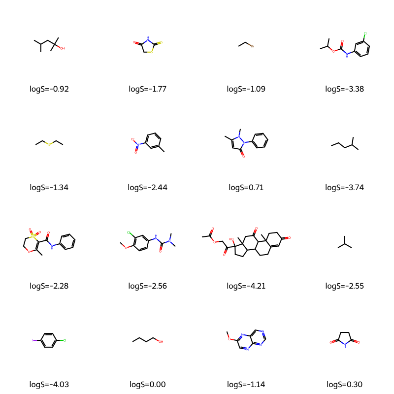

# Can you predict how well a molecule dissolves in water using machine learning?

I'm a second-year Chemistry with Maths student at UCL, and I wanted a small project that put machine learning to work on a real chemistry question. Solubility is a good one: it matters for drug design and environmental chemistry, and chemists already have decent rules of thumb for it (polar groups help, big greasy aromatic systems hurt). So the question is how much of that a model can pick up from structure alone.



*A random sample of 16 molecules from the dataset, labelled with their measured logS. The flat, ring-heavy hydrocarbons sit at the insoluble end, as expected.*

## Where I've got to

So far I have:

- loaded the ESOL (Delaney) dataset and turned every SMILES string into an RDKit molecule
- checked the data: 1,128 molecules, no missing values, no duplicates, and every structure parses
- looked at the spread of the target (logS runs from about -11.6 to +1.6, averaging around -3)
- calculated seven RDKit descriptors and fitted a baseline, linear regression and random forest
- compared a random split with a scaffold split, to see how much a model's score depends on test molecules resembling the training ones
- looked at where the model goes wrong (see Results)

Still to do:

- add element-count features and/or Morgan fingerprints and see whether the errors on phosphorus compounds drop
- use cross-validation so the scores don't depend on a single split

## The data

ESOL is a well-known benchmark of 1,128 small molecules with measured aqueous solubility, given as SMILES strings and logS (the log of solubility in mol/L). The code downloads the DeepChem copy the first time you run it and saves it as `delaney-processed.csv`, so after that it works offline.

Delaney, J. S. *ESOL: Estimating Aqueous Solubility Directly from Molecular Structure.* J. Chem. Inf. Comput. Sci. 2004, 44, 1000-1005.

## Results

The largest errors were mostly organophosphorus compounds. On the test set, the 8 phosphorus-containing molecules had a mean absolute error of 1.94 log units, compared with 0.56 across all test molecules, and the model tended to predict them as less soluble than measured. None of my seven descriptors encodes phosphorus directly, so adding element counts or fingerprints is the obvious next step.

## What's in the repo

- `Solubility.py` has two helper functions: `load_data()` and `explore()`
- `molecules.ipynb` is the notebook where I load, check and look at the data
- `delaney-processed.csv` is the cached dataset
- `sample_molecules.png` is the picture above, made by `explore()`
- `requirements.txt` lists the Python packages

## Running it yourself

Python 3 is required

```bash
git clone https://github.com/Ash679-ux/chem-ml-solubility.git
cd chem-ml-solubility

python3 -m venv .venv
source .venv/bin/activate      # on Windows PowerShell: .venv\Scripts\Activate.ps1

pip install -r requirements.txt
```

Then open `molecules.ipynb` and run the cells, or use the functions directly:

```python
from Solubility import load_data, explore

df = load_data()   # columns: smiles, logS, mol
explore(df)        # prints summary stats and saves sample_molecules.png
```

## Tools

Python, pandas, NumPy, scikit-learn, RDKit, Jupyter and Matplotlib.

## About me

I'm Ashwin, looking for chemistry-related or quantitative analysis internships for summer 2027. If you've got feedback on the project or want to talk about it, I'd be glad to hear from you.